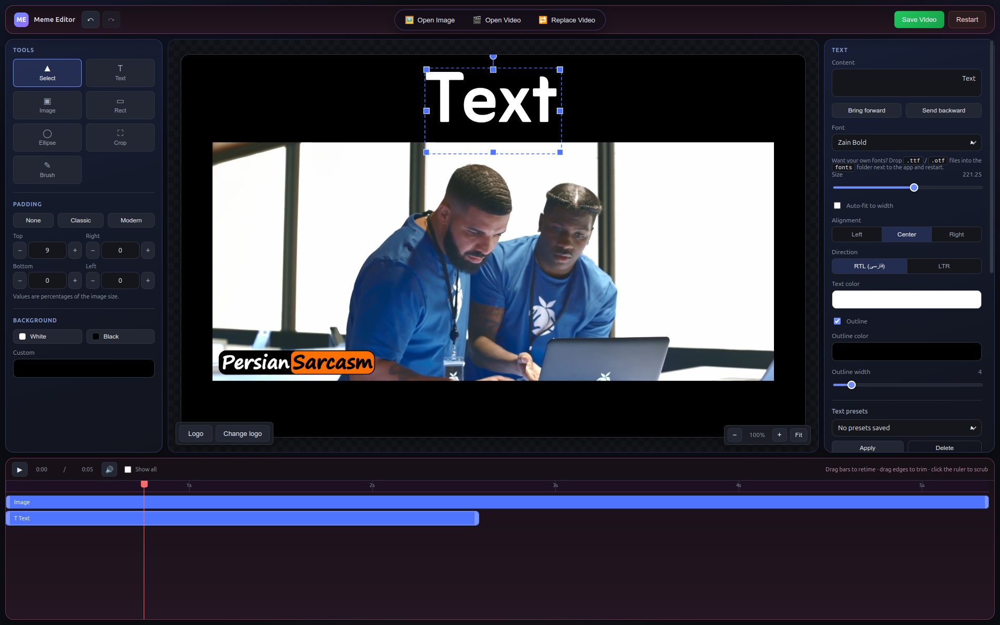

<p align="center">
  
</p>

<h1 align="center">Meme Editor</h1>

<p align="center">
  A fast, modern, offline meme editor. Load an image or video, add text, stickers,
  shapes and brush strokes, pad it like a classic meme, and export a PNG — or a
  video with timed overlays — all from a native desktop app for Windows and Linux.
</p>

<p align="center">
  <a href="https://github.com/TheFeij/MemeEditor/actions/workflows/release.yml">
    
  </a>
  <a href="https://github.com/TheFeij/MemeEditor/releases/tag/v1.2.0">
    
  </a>
</p>

> [!NOTE]
> This project is **vibe coded** — it was built iteratively by prompting **DeepSeek V4 Flash** agent, and this
> README was written by **DeepSeek V4 Flash**. Expect pragmatic, working software
> rather than a hand-crafted, artisanal codebase.
>
> The original [`plan.md`](plan.md) — the initial design and implementation plan — was
> discussed and prepared with **GPT-5.6** in a chat on the [ChatGPT website](https://chatgpt.com/).

---

## Features

- **Start screen** — begin with an image, a video, or an empty canvas with a custom size and background color.
- **Image input** — open a file, drag & drop from your OS, or paste from the clipboard.
- **Video memes** — open a video, edit it exactly like an image, and give every text,
  shape, sticker or brush stroke its own **start / end time** on a CapCut-style timeline
  (drag a bar to retime it, drag its edges to trim, and click the ruler to scrub).
  Export to MP4 (keeping the original audio) via ffmpeg.
- **Image layers** — stack extra images (logos, stickers) on top of the base image, resize/rotate them, and crop them in place.
- **Replace base image** — swap the underlying meme while keeping text, stickers and shapes in place.
- **Text tool** — content, font, size, alignment, color and outline, with auto-fit and max-size options.
- **RTL / LTR direction** — right-to-left is the default writing direction (great for Farsi/Arabic with embedded English).
- **Custom fonts** — drop your own `.ttf` / `.otf` / `.woff` / `.woff2` files into the `fonts` folder shipped with the app.
- **Text presets** — save, apply, rename and delete reusable text styles, and set a default for all new text.
- **Shapes** — rectangles (with corner radius) and ellipses that can be painted as a solid color or as a live **background blur**.
- **Brush** — freehand draw, cover/remove, or blur the background.
- **Rotate** — rotate any object with its rotate handle (hold `Shift` for 15° steps) or the rotation controls.
- **Eyedropper** — every color picker has an eyedropper button to sample a color straight from the canvas.
- **Logo quick-access** — save a logo once and drop it onto the canvas with one click.
- **Padding** — percentage-based padding per side, with Classic and Modern presets.
- **Background** — any custom color, applied to the canvas and used as the default shape fill.
- **Arrange** — bring forward / send backward, and delete the selected object.
- **Undo / redo** — a full history of your edits.
- **Themed UI** — custom dropdowns and a built-in color picker designed for the app.
- **Export** — save the composition as a PNG (image projects) or an MP4 video (video
  projects) via a native save dialog, remembering the last folder you used.

## Download

Grab the latest release from the [Releases](https://github.com/TheFeij/MemeEditor/releases) page:

| Platform | Archive | Contents |
| --- | --- | --- |
| Linux (x64) | `MemeEditor-*-linux-x86_64.AppImage` | portable Linux app |
| Linux (x64) | `MemeEditor-*-linux-x64.zip` | unpacked Linux app |
| Windows (x64) | `MemeEditor-*-win-x64.zip` | unpacked Windows app |

The app is built on Electron and ships its own Chromium runtime, so no extra
system libraries are required.

> [!NOTE]
> **Video memes use a bundled `ffmpeg`.** Packaged builds ship a static `ffmpeg`
> binary (fetched into `resources/` at build time), so exporting video works out
> of the box. If the bundled binary is missing, the app falls back to an
> `ffmpeg` on your `PATH` (e.g. `sudo apt-get install ffmpeg` on Debian/Ubuntu).
> The app calls `ffmpeg` to encode the frames and re-mux the original audio track.

## Custom fonts

The app bundles some fonts (Zain, Vazirmatn) and also loads any fonts found in a
`fonts` folder shipped alongside the app's resources (or a `fonts` folder in the
working directory when running from source):

```
resources/
  fonts/
    MyriadArabic-Regular.otf
    MyFont-Bold.ttf
    ...
```

Supported formats: `.ttf`, `.otf`, `.woff`, `.woff2`. The family name is derived
from the file name (`MyriadArabic-Regular.otf` → "MyriadArabic Regular").
Restart the app after adding or removing fonts and they'll appear in the font list.

## Build from source

### Prerequisites

- [Node.js](https://nodejs.org/) 20+ and npm

### Build

```bash
npm install          # install dependencies
npm run dev          # Vite dev server + Electron with HMR
npm run build        # compile the renderer (Vite) and main/preload (tsc)
npm start            # build then launch the compiled app
npm run typecheck    # tsc for the renderer and the main process
npm run fetch:ffmpeg # download a static ffmpeg into resources/ (once per platform)
npm run package      # electron-builder -> release/ (AppImage + zip on Linux, zip on Windows)
```

`npm run package` runs `fetch:ffmpeg` automatically, so every packaged build
contains an `ffmpeg` binary. Use `npm run fetch:ffmpeg -- --force` to refresh it.

Packaged artifacts are written to `release/`.

## Keyboard shortcuts

| Key | Action |
| --- | --- |
| `V` | Select |
| `T` | Text |
| `B` | Brush |
| `R` | Rectangle |
| `E` | Ellipse |
| `C` | Crop |
| `I` | Eyedropper into the last color picker you opened |
| `Space` | Play / pause a video |
| `Delete` / `Backspace` | Delete selected object |
| `Esc` | Cancel eyedropper / crop / image crop |
| `Ctrl/Cmd + Z` | Undo |
| `Ctrl/Cmd + Shift + Z` | Redo |
| `Ctrl/Cmd + S` | Save image / video |

## Tech stack

- **Renderer** — React + TypeScript with the HTML5 Canvas API, built with Vite.
- **Main process** — Electron (TypeScript). It:
  - opens native file/save dialogs and reads image and video files,
  - writes the exported PNG or MP4,
  - applies the pixel **blur** used by the blur paint mode (worker-threaded),
  - composites each timed object as a PNG overlay in a single `ffmpeg` pass (fast, keeps the original audio),
  - scans the drop-in `fonts` folder and hands user fonts to the renderer at runtime,
  - persists preferences to a per-user config file.

## Project structure

```
.
├── electron/               # Main process (TypeScript)
│   ├── main.ts             # Window + app lifecycle
│   ├── preload.ts          # contextBridge -> window.meme
│   ├── ipc.ts              # IPC handlers (dialogs, file IO, ffmpeg, blur, fonts, prefs)
│   ├── config.ts           # Preferences + last save dir (userData JSON)
│   ├── blur.ts             # Box blur via nativeImage + worker_threads
│   ├── fonts.ts            # Drop-in font discovery
│   └── ffmpeg.ts           # Single-pass overlay/blur export
├── src/                    # Renderer (React + TypeScript)
│   ├── components/         # UI components
│   ├── state/              # Reducer store + EditorContext
│   ├── lib/                # constants, document geometry, rendering, image helpers
│   ├── styles/style.css    # Themed styling
│   └── assets/fonts/       # Bundled fonts (Zain, Vazirmatn)
├── resources/fonts/        # Drop-in fonts shipped with packaged builds
├── scripts/                # fetch-ffmpeg.mjs (bundles a static ffmpeg)
├── index.html              # Renderer entry HTML
├── vite.config.ts          # Vite build + per-mode CSP
├── package.json            # Scripts + electron-builder config
├── logo.svg / logo.png     # App logo and generated icon
└── .github/workflows/      # CI: build & release for Linux and Windows
```

## Credits

Bundled fonts:

- [Zain](https://github.com/google/fonts/tree/main/ofl/zain) — SIL Open Font License
- [Vazirmatn](https://github.com/rastikerdar/vazirmatn) — SIL Open Font License

See the `OFL.txt` files under `src/assets/fonts/` for details.

---

<p align="center"><em>Vibe coded with DeepSeek V4 Flash</em></p>
